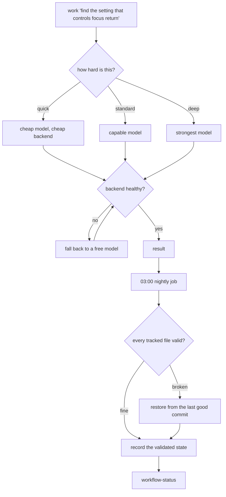

# Self-Healing Coding Workflow


**One configuration for Codex, OpenCode and Command Code that repairs itself, remembers what it learned, and picks the right model for the job.**

MIT · Windows 10/11 with PowerShell 5.1 · Author: [Farhan Khan (@thebetterfarhan)](https://github.com/thebetterfarhan)

---

## The problem

Three coding CLIs, three configuration folders, one policy that drifts the
moment you edit a single copy. A model pinned in two places that disagree. A
file somebody truncated at 03:00 and nobody notices until Monday.

## What this is

A single configuration, held in a git repository, that:

- **holds one policy** and copies it byte-identically into all three CLIs, with
  a check that fails on drift;
- **picks the model in one place** - per role, per task tier, per backend -
  with a free-model fallback and a demotion when a backend keeps failing;
- **repairs itself at 03:00** - validates every tracked file, restores a broken
  one from the last good commit, and rolls back any step that fails;
- **remembers** what it learned, as a taste file that reaches every agent;
- **guards** the dangerous paths, refusing patches that touch signing keys or
  carry secret-shaped text.

## How it works



## What it looks like

One command, and the route it picked:

```powershell
work 'Find the setting that controls focus return' -Preview
```

````text
  (backend ranking: opencode(ok) > codex(ok) > commandcode(ok))

Agent    : opencode
Tier     : quick
Model    : opencode/deepseek-v4.1-flash-free
Effort   : (none)
EstCost  : n/a (static table)
WorkDir  : ~/Documents/Codex
ReadOnly : True
Mode     : read-only
Fallback : codex (gpt-6-luna)
````

And the state of the whole thing, on demand:

```powershell
workflow-status
```

````text
Workflow status

Install
  policy                  in sync across 3 CLIs (61E071FD)
  skills                  76 canonical, rendered into all three CLIs
  roster                  4 agents rendered
  taste                   35 entries (edit to make them yours)
  guard hook              wired (PreToolUse)

Configuration repo
  files                   clean - f37470b workflow: record the validated configuration

Nightly repair
  task                    Ready (2026-10-17T03:00:00-05:00)
  last run                10/20/2026 10:45:45   result 0
  next run                10/21/2026 3:00:00
  last steps              run complete ok=12 failed=0
  last failure            none recorded

Drift
  sync-agents             in sync
  sync-agent-instructions in sync
  sync-skills             in sync
  sync-taste              in sync
````

Both screens are captured from a live install. The path and the commit hash
are the only things changed.

## Install

Unzip anywhere, for example `~/Documents/Codex`, then:

```powershell
cd tools
powershell -NoProfile -ExecutionPolicy Bypass -File ./setup.ps1
```

`setup.ps1 -Check` reports what it would do and writes nothing - look before
you leap.

Open a **new** PowerShell window afterwards (the profile loads at start) and:

```powershell
work 'Find the setting that controls focus return' -Preview
```

`-Preview` shows the route - backend, model, reasoning effort - without
spending a token on the run. Then read
**[START-HERE.md](START-HERE.md)**: it is the shortest path from "installed"
to "useful".

## One policy, three agents, one model table

| Piece | Where | What it does |
| --- | --- | --- |
| Policy | `~/.codex/AGENTS.md` | The rules every agent follows: how to work, what needs approval, how to verify, how to report. Copied byte-identical into Codex, OpenCode and Command Code. |
| Roster | `workflows/agents.toml` | scout, builder, verifier, debugger - and the model each one runs on, for every backend. |
| Router | `tools/agent-route.ps1` | Reads the request, grades it quick, standard or deep, and picks the model and the backend. |
| Taste | `~/.commandcode/taste/taste.md` | Your preferences. One edit reaches all three CLIs. |
| Guard | `tools/guard-hook.ps1` | Denies patches that touch signing keys or carry secret-shaped text. |
| Status | `tools/status.ps1` | One screen: install state, drift per layer, backend health, spend. |

## The model table, in one file

`workflows/agents.toml` is the only place a model is chosen. The role pins and
the tier table live together, so they cannot drift apart.

| Role | Codex | OpenCode | Command Code |
| --- | --- | --- | --- |
| scout - finds code, never edits | `gpt-6-luna` / low | `opencode/deepseek-v4.1-flash-free` / low | `poolside/laguna-s-2.1-free` / low |
| builder - the only one that writes | `gpt-6-sol` / high | `opencode/deepseek-v4-pro` / high | `deepseek/deepseek-v4-pro` / high |
| verifier - reviews and runs the checks | `gpt-5.6-terra` / medium | `opencode/deepseek-v4.1-flash` / medium | `gpt-6-luna` / medium |
| debugger - root cause, then the fix | `gpt-6-astra` / high | `opencode/gpt-5.3-codex` / high | `deepseek/deepseek-v4-pro` / high |

The task tier is a second axis: `quick` takes the cheap end, `deep` the strong
end. When a backend is plan-restricted, over its usage window, or simply
broken, the router falls back to a free model instead of failing.

## What stays on your machine

- **Your taste.** The bundle ships a starter; your own preferences live in
  `~/.commandcode/taste/` and are git-ignored.
- **Your addresses.** Personal leak patterns live in
  `tools/leak-patterns.local.json`, which is git-ignored and never packaged.
- **Your machine paths.** The packer refuses to ship a bundle containing one.
- **A remote.** The configuration repository is local. Nothing is pushed
  unless you push it.

## The skill set

The canonical skill set is **not** bundled. The workflow works without it: the task cues run as prose instructions.

## Requirements

- Windows 10/11 with PowerShell 5.1.
- git.
- At least one coding CLI - Codex, OpenCode or Command Code. The workflow
  degrades gracefully when one is missing.

Optional: **rtk**, a token-saving command wrapper - without it, commands run
normally. The **Superpowers skills**, guided workflows for the four task cues.
And **audio feedback**, which is never installed by default.

## Commands worth knowing

| Command | What it does |
| --- | --- |
| `work '<request>'` | Route a task to the right backend and model. `-Preview` shows the route first. |
| `workflow-status` | One screen: install state, nightly job, drift, backend health, spend. Exit 0 means healthy. |
| `worktree '<name>'` | An isolated git worktree for risky work. |
| `reload` | Re-read the PowerShell profile after editing it. |
| `taste-sync` | Re-render your preferences into every agent's instruction file. |

## The nightly job

At 03:00 a scheduled task re-syncs the configuration, refreshes the model
catalogs, distils the day's sessions into memory, and rolls back any step that
fails. Log: `tools/self-repair.log`.

Turn it off:

```powershell
Unregister-ScheduledTask CodexWorkflowSelfHeal -Confirm:$false
```

## Verify the download

Every release ships a `SHA256SUMS.txt` beside the zip. After downloading it:

```powershell
Get-FileHash .\self-healing-coding-workflow-vX.Y.Z.zip -Algorithm SHA256
```

Compare the value with the line for the same file in `SHA256SUMS.txt`.

The packer refuses to build a bundle that contains a private key, a token, a
machine path, a generated taste block, or anything matching your personal leak
patterns - so the zip you download is the one that was checked.

## Documentation

**[Read it in a browser](https://thebetterfarhan.github.io/self-healing-coding-workflow/)** - the same documentation, rendered for a screen reader and published as a site.

| Document | What is in it |
| --- | --- |
| [START-HERE.md](START-HERE.md) | The shortest path from "installed" to "useful". |
| [SELF-HEALING-WORKFLOW.md](SELF-HEALING-WORKFLOW.md) | The complete reference, basics to advanced. |
| [WORKFLOW-USAGE.md](WORKFLOW-USAGE.md) | Operator quick reference. |
| [tools/AGENT-SETUP.md](tools/AGENT-SETUP.md) | The agent roster, the router, the cross-CLI handoffs. |
| [html/](html/) | The same documentation as HTML, built for a screen reader. |

## License

MIT. See [LICENSE](LICENSE).
